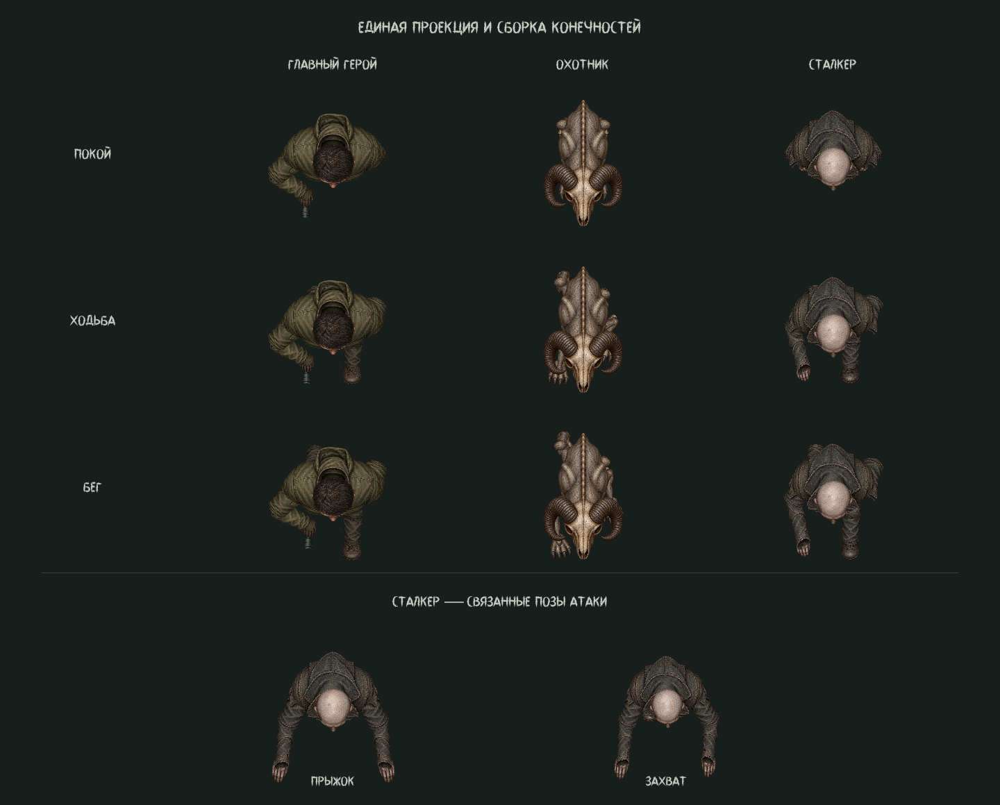

# Охотник и сталкер: модели по образцу героя

Этот документ описывает предыдущую версию. [Актуальные модели по новым
референсам, разбор героя и промпты](creatures-reference-redesign.md).

Оба персонажа используют полный набор отдельных рисованных деталей в строгом
виде сверху. На каждой стороне сохранены стопа, голень, бедро, колено, плечо,
верх руки, предплечье, локтевая складка и кисть. Корпус и голова перекрывают
корни конечностей; верх ботинка скрыт штаниной, запястье — рукавом.

В `monster_body.tscn` и `stalker_body.tscn` сохранено по 20 настоящих `Sprite2D`.
Редактор и игра используют одни текстуры и один расчёт позы. В инспекторе
доступны `preview_state`, `preview_cycle`, `preview_direction` и
`preview_animation`. В `AnimationPlayer` сохранены редактируемые `idle`, `walk`,
`run`, `RESET`, у сталкера также `stalk`, `flee`, `leap` и `grab`.

Сталкер использует проекцию свободных рук героя: плечо, локоть и кисть соединены,
локоть согнут наружу, рука идёт в противофазе одноимённой ноге. При атаке эта же
цепь плавно вытягивается, затем возвращается к походке. Охотник сохраняет
четвероногий силуэт и диагональную рысь с опорой в течение 64% шага; длина
конечностей проецируется на вид сверху, и корпус закрывает поджатые части.
Фаза походки у обоих зависит от пройденной дистанции.

Старые атласы этой версии удалены при очистке 20.10.2026. Текущие текстуры
и промпты перечислены в [актуальном описании](creatures-reference-redesign.md).

## Новые текстуры и промпты

Все детали заново сгенерированы встроенным ImageGen. Атлас героя использован как
образец материалов, света, вида сверху и раздельной сборки; прежние атласы
монстров — как образцы их внешности. Сохранены череп барана и серая кожа охотника,
бледная лысая голова и тёмная потёртая одежда сталкера.

Исходные PNG имеют настоящую прозрачность. `AtlasTexture` ссылаются на их
неизменённые пиксели. Локтевые складки берутся из ткани/кожи предплечья, как у
героя, и смягчаются общим `sleeve_fold.gdshader`. Регионы записаны в
`atlas_regions.json`. Скрипт `tools/build_creature_atlases.py` воспроизводит
ресурсы атласов, `tools/build_creature_bodies.gd` — сцены и библиотеки анимаций.
Устаревшие команды `bake_actor_bodies`, `bake_monster_body`, `bake_stalker_body`
удалены при очистке. Используйте `tools/build_creature_bodies.gd`.

## Предпросмотр

[Цикл движения всех трёх персонажей](visuals/creature_2d_v3_motion.gif).
`tests/creature_2d_preview.gd -- --motion` сохраняет PNG и 32 кадра анимации
в `.godot/creature_preview_frames`.

## Проверки

Godot 4.7.2: `creature_2d_regression`, `overhead_pose_regression`,
`player_2d_regression`, `articulated_regression`, `gameplay_smoke`.
Проверяются сохранённые узлы и позы, прозрачность атласов, порядок слоёв,
скрытие ног под корпусом, восемь направлений ходьбы/бега, непрерывность суставов,
соединения деталей, координация шага и переходы сталкера к атаке и обратно.

В расширенном `hardcore_stalker_regression` остаётся прежняя ошибка проверки
расстояния светильника `CeilingLamp2`: 559,42 при пороге 500. Позиция светильника
и его `previous_position` совпадают с исходным Git HEAD. Проверки новой модели
и атаки проходят. Старый `overhead_hunters_regression` также содержит неактуальные
ожидания двух монстров в харде и пяти светильников (сейчас три и шесть), затем
обращается к отсутствующему у сталкера `hearing_multiplier`. Эти несвязанные
проверки не изменялись. Рендер выполнен D3D12; движок сообщает о недоступном
кеше шейдеров `user://`. Экспорт исполняемой версии не выполнялся.
