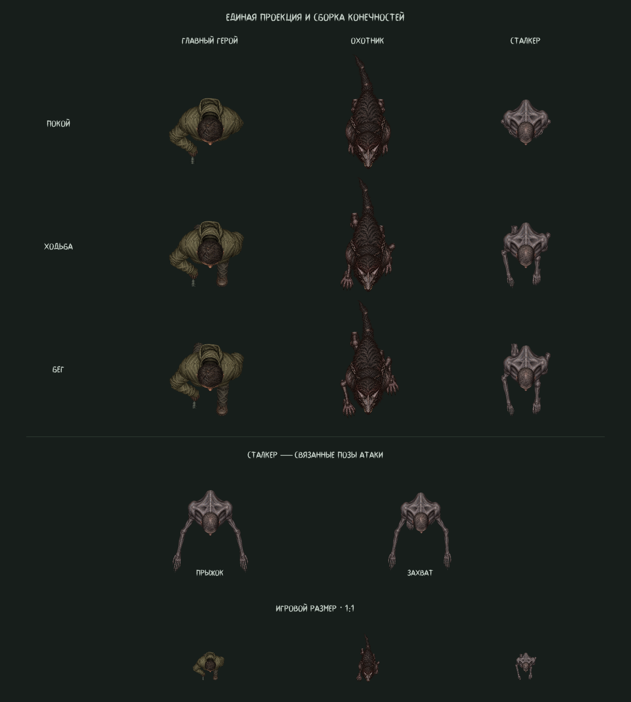

# Новые референсы охотника и сталкера

Активные модели: `scenes/actors/monster_body.tscn` и
`scenes/actors/stalker_body.tscn`. Актуальные текстуры охотника находятся в
`rig_v5`, сталкера — в `rig_v4`.
Последующая [коррекция тяжёлого силуэта охотника](hunter-silhouette-v5.md)
описана отдельно. Ниже сохранён разбор исходной стилистики и сталкера;
текстуры и модель главного героя сохранены без изменений.

## Что изучено у главного героя

Разобраны исходный `overhead_parts.png`, все `AtlasTexture`, сохранённая сцена,
`player_2d_rig.gd`, `sleeve_fold.gdshader`, промпт и предпросмотр движения.

| Свойство героя | Как продолжено у новых персонажей |
| --- | --- |
| Реалистичная рисованная фактура с мелкими нерегулярными деталями | Шерсть, железо и кожа имеют похожую плотность деталей, приглушённую палитру и мягкий верхний свет |
| Компактный корпус 58×43, голова 27×28, камера строго сверху | Сохраняется потолочная проекция; размеры и силуэты изменены под анатомию референсов |
| Истинный альфа-канал, отдельные вырезки, линейная фильтрация | Новые PNG сохраняют исходные пиксели и прозрачность; детали подключены через `AtlasTexture` |
| Стопа −10, голень −9, бедро −8, колено −7; кисть −4, предплечье −3, плечо −2, локоть −1; корпус 1, голова 5 | Этот порядок слоёв сохранён; у охотника хвост лежит глубже ног, грива между корпусом и головой |
| Свободная рука — связная цепь с физическими длинами 18/21 и меняющейся проекцией | Конечности поджаты по высоте в покое; видимые участки раскрываются при шаге, кисти следуют за локтями |
| Локтевая складка — фрагмент материала предплечья с мягким краем | На сгибах используется собственная кожа/шерсть и тот же шейдер, закрывающий стык |
| Шаг зависит от пройденной дистанции, а не от частоты кадров | Сохранены плавные переходы покой/ходьба/бег и непрерывная фаза |
| Сохранённые спрайты и клипы редактора совпадают с игровой моделью | У охотника 24 сохранённых спрайта, у сталкера 20; те же позы доступны в инспекторе и `AnimationPlayer` |

## Охотник

Первый предоставленный референс задаёт косматого четвероногого зверя: тёмную
спину, иссохшие серо-фиолетовые конечности, длинные когти, железную вытянутую
маску и цепи. Новые текстуры передают эти материалы в стилистике героя.
Грива соединяет плечи с маской; хвост собран из трёх связанных сегментов с
запаздывающим покачиванием. Задние колени поджаты под мех. Охотники в обоих
режимах используют эту общую сцену. Диагональная рысь сохраняет 64% опорной фазы.

- [Текстуры охотника](../assets/characters/monster/rig_v5/overhead_parts.png)
- [Точный промпт](../assets/characters/monster/rig_v5/generation_prompt.txt)
- [Сохранённый референс](../assets/characters/references/hunter_concept.png)

## Сталкер

Второй референс задаёт голое истощённое существо с натянутой тёмной кожей,
выраженными лопатками, тонкими конечностями, редкими волосами и длинными
искривлёнными когтями. Корпус сужен до 44×38, голова до 20×24; размеры
сегментов и кистей подогнаны под эту анатомию. Материал дополнительно уточнён
отдельным проходом генерации: мягкие переходы кожи, жилы и складки.
Прыжок и захват используют эти же плечи, локти и кисти.

- [Текстуры сталкера](../assets/characters/stalker/rig_v4/overhead_parts.png)
- [Точный промпт](../assets/characters/stalker/rig_v4/generation_prompt.txt)
- [Промпт уточнения материала](../assets/characters/stalker/rig_v4/refinement_prompt.txt)
- [Сохранённый референс](../assets/characters/references/stalker_concept.png)

Новые атласы созданы встроенным ImageGen с реальным альфа-каналом. Атлас героя
передан как образец стилистики, пользовательские изображения — как образцы
внешности. При выделении стоп ресурс обрезает верх вертикального голеностопа,
который заменяется независимой голенью. Это закрывает искусственный срез при
шаге назад и сохраняет исходные пиксели PNG. Точные вырезки указаны в
`atlas_regions.json`, исходные детали также доступны как `foot_source` и
`elbow_source`.

## Редактор и проверка

Откройте соответствующий `*_body.tscn`. `preview_state`, `preview_cycle`,
`preview_direction` и `preview_animation` управляют той же моделью, что и игра.
Сохранены `idle`, `walk`, `run`, `RESET`; у сталкера также `stalk`, `flee`,
`leap`, `grab`. Исходные референсы сохранены в проекте.

[Предпросмотр движения](visuals/creature_2d_v4_motion.gif).
Генераторы: `tools/build_creature_atlases.py`, `tools/build_creature_bodies.gd`.
`tests/creature_2d_preview.gd -- --motion` сохраняет 32 кадра в
`.godot/creature_v4_preview_frames`.

Проверки Godot 4.7.2: `creature_2d_regression`, `overhead_pose_regression`,
`articulated_regression`, `gameplay_smoke`, `player_2d_regression`.
Они проверяют сохранённую сборку, слои, прозрачность, все восемь направлений,
связность суставов, фазу шага, переходы атаки и непрерывность трёх частей хвоста.
Все пять проверок завершились без ошибок. В покое проекции бёдер, голеней и
коленей полностью перекрываются границами корпуса у обоих персонажей. На
сетке из 241 позы максимальное изменение сустава охотника — 1,601 пикселя,
сталкера — 0,982; у хвоста — 0,227. Ошибка соединения деталей меньше 0,00001
пикселя. Дополнительно визуально проверено перекрытие реальными силуэтами.
Отдельный рендер D3D12 просмотрен в увеличении и при масштабе 1:1.
Движок сообщает о недоступном кеше шейдеров `user://`; рендер сохраняется.
Экспорт исполняемой версии не выполнялся.
