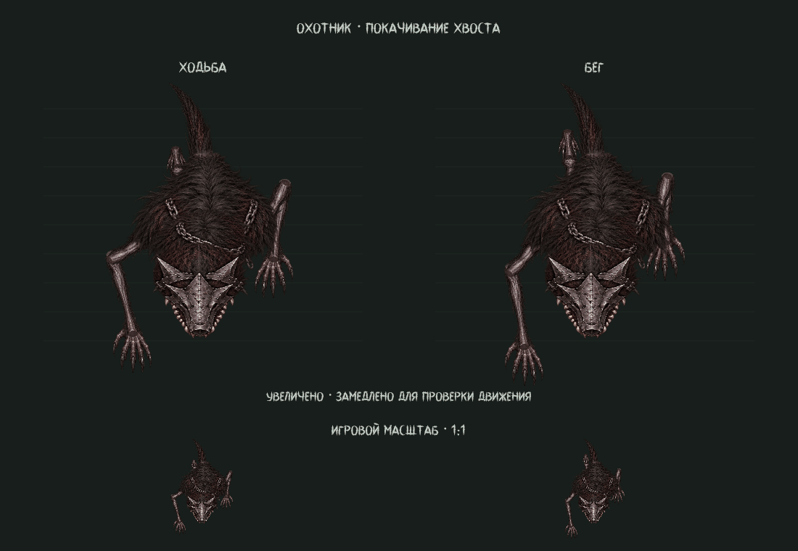

# Охотник: цельный хвост и опорная походка

Активная модель сохранена в `scenes/actors/monster_body.tscn`:
23 `Sprite2D` и один текстурированный `Polygon2D` хвоста. Редактор и игра
используют те же узлы и тот же расчёт позы в `hunter_rig.gd`.

## Хвост

Три отдельные жёсткие вырезки заменены одной непрерывной полосой с 20 секциями.
Соседние секции используют общие вершины. Полоса изгибается вдоль кубической
кривой, сужается к концу и получает запаздывающее покачивание. Текстура меха
берётся из исходного атласа `rig_v5`, без стыков разных кусков и отдельного
S-образного наконечника. Корень скрыт спиной, свободная часть проходит над
пересекающими её задними ногами. Геометрия, UV и анимация сохранены в сцене.

Хвост заметно машет влево и вправо относительно спины, с запаздыванием кончика.
В покое один взмах занимает 2,6 секунды, в движении — два полных цикла шага.
Отдельная фаза хвоста сохраняет покачивание при остановке лап. Основание
остаётся на месте; клипы редактора содержат полный замкнутый взмах.

## Передние конечности

Шаг имеет отдельные фазы опоры и переноса. На опоре кисть сохраняет направление,
а её движение относительно корпуса компенсирует пройденное телом расстояние.
Длина цикла связана с размахом лапы и долей опорной фазы. Перенос использует
кривую с согласованными скоростями на отрыве и постановке; подъём начинается и
заканчивается без скачка вертикальной скорости.

Плечо, локоть и запястье рассчитываются с учётом высоты над землёй. Рука может
согнуться назад под гриву и затем вытянуться вперёд, сохраняя суставную цепь.
Кисть не поворачивается вслед за осью предплечья во время опоры и не меняет
размер при подъёме. Задние лапы используют тот же опорный цикл и диагональную
координацию. Голеностопы закрыты сохранёнными мягкими складками кожи.

Клипы редактора и `preview_animation` используют частоты, соответствующие
обычной скорости 115 и скорости бега 340. Для визуальной проверки подготовлен
увеличенный замедленный показ с движущимися отметками пола:

`tests/hunter_motion_preview.gd` сохраняет 48 кадров в
`.godot/hunter_motion_frames` и статичный `hunter_tail_wag.png`.

## Проверки

Godot 4.7.2: `creature_2d_regression`, `articulated_regression`,
`overhead_pose_regression`, `gameplay_smoke` прошли без ошибок.
Проверены восемь направлений, непрерывность скоростей на границах фаз,
сохранение опоры, связность суставов, отсутствие перевёрнутых/схлопнутых
секций хвоста, непрозрачность его середины и совпадение анимации хвоста в
`AnimationPlayer` с игровой позой.

В тесте опоры остаточное смещение кисти относительно пола меньше 0,00001
пикселя. Максимальное изменение сустава на сетке 241 позы — 1,402 пикселя.
Для хвоста проверены 481 поза: максимальное смещение кончика между соседними
позами — 0,542 пикселя; он пересекает обе стороны корпуса без разрывов.
Исходные текстуры и их альфа-канал сохранены.
Движок сообщает о недоступном кеше шейдеров `user://`; PNG-рендер успешен.
Экспорт исполняемой версии не выполнялся.
