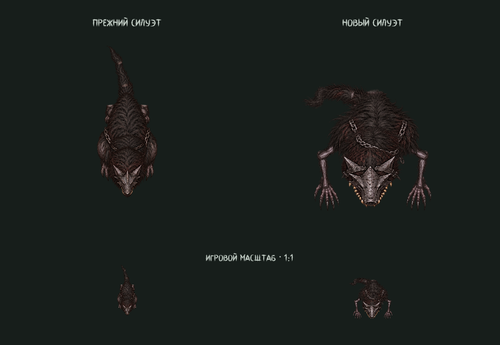

# Охотник: сутулый зверь с тяжёлой передней частью

Актуальная [правка хвоста и опорной походки](hunter-motion-v6.md) заменяет
описанную ниже конструкцию хвоста и прежнюю анимацию рук.

Активная сцена — `scenes/actors/monster_body.tscn`, текстуры —
`assets/characters/monster/rig_v5`. Обе игровые особи используют эту сцену.

Спина расширена до 68×58: основная масса меха сосредоточена на плечах.
Маска увеличена до 46×46 и получила широкие щёчные пластины, клыки и крупные
волчьи уши. Длинные передние конечности сохраняют опорную согнутую стойку и
заканчиваются большими когтистыми кистями. Физические длины плеча/предплечья —
23/29, проекция меняется от 72% в покое до 95% при беге. Корни скрыты гривой.
Густой хвост собран из трёх связанных частей и загнут в боковую дугу за тазом.

Все детали заново созданы встроенным ImageGen по исходному референсу;
текстуры героя использованы как образец рисованной фактуры и света.
Исходный PNG имеет настоящий альфа-канал. Выделение деталей учитывает отдельные
связные острова и исключает края соседних элементов из прямоугольных вырезок.

- [Новый атлас](../assets/characters/monster/rig_v5/overhead_parts.png)
- [Точный промпт](../assets/characters/monster/rig_v5/generation_prompt.txt)
- [Исходный референс](../assets/characters/references/hunter_concept.png)
- [Предпросмотр движения](visuals/creature_2d_v5_motion.gif)

Сохранены 24 настоящих спрайта и редактируемые клипы покоя, ходьбы и бега.
Процедурная поза и сохранённая поза совпадают; модель видна в редакторе.
Ключ `--hunter-only` у сборщиков позволяет пересохранить только охотника.

Godot 4.7.2: `creature_2d_regression`, `overhead_pose_regression`,
`articulated_regression`, `gameplay_smoke` прошли без ошибок. Проверены восемь
направлений, связь суставов, наружный сгиб локтей, движение хвоста и сохранённые
позы. Максимальная ошибка соединения меньше 0,00001 пикселя, размах кисти в
игровом тесте — 25,58 пикселя. Рендер D3D12 просмотрен в масштабе 1:1 и в
увеличении. Движок сообщает о недоступном кеше шейдеров `user://`.
