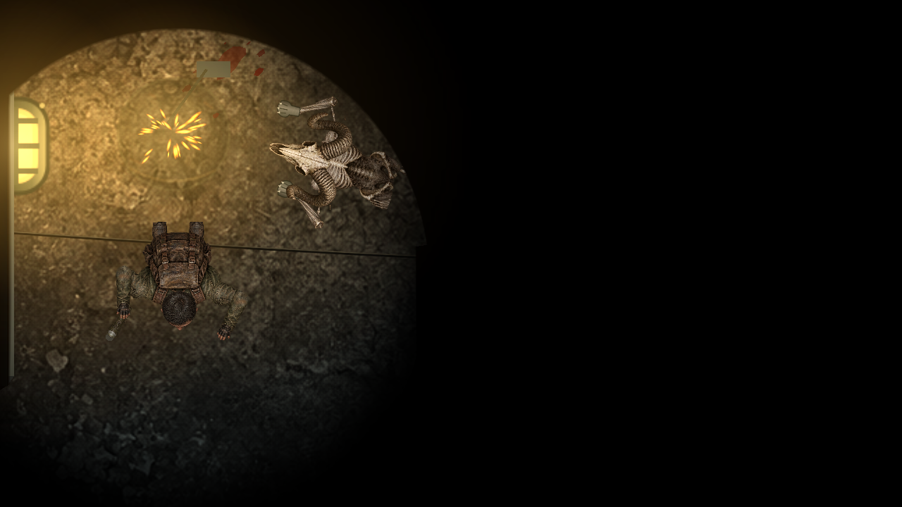
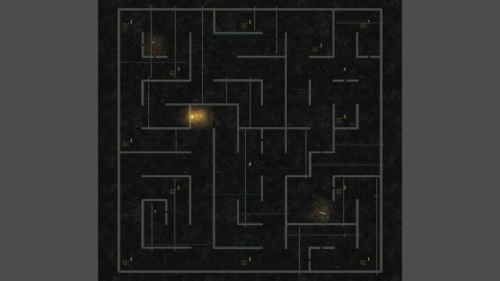

# Два монстра, баланс предметов и потолочные коммуникации

## Режимы

| Параметр | Обычный | Хард |
|---|---:|---:|
| Монстры с начала игры | 2 | 2 |
| Батарейки на карте | 5 | 4 |
| Множитель слуха | 1,0 | 1,22 |
| Угол обзора | 105° | 125° |

Батарейки размещены в четырёх удалённых частях карты; пятая находится ближе к центру и убирается в харде. Между любыми двумя батарейками более 1300 единиц. Дальность зрения, скорости и восстановление монстров сохранены. Стены по-прежнему уменьшают радиус слышимости до 45%; слух не раскрывает текущую позицию игрока через стену. Второй монстр выбирает стартовую точку вдали от игрока и первого монстра. Оба монстра сохранены в game.tscn и видны в редакторе.

## Походка и вой

Передние лапы получили компактную текстуру с тремя пальцами и когтями. Передние конечности складываются вдоль корпуса; диагональная рысь связывает переднюю левую лапу с задней правой и наоборот. Фаза шага зависит от пройденного расстояния. На опорную фазу приходится 64% цикла, затем лапа переносится вперёд по плавной дуге. При ускорении увеличивается длина шага. Поза сохранена в monster_body.tscn; промежуточные части задних ног не добавлялись.

У двух монстров одно расписание воя: один вой сразу после начала игры, затем через 26–40 секунд от начала предыдущего. Соседние интервалы отличаются минимум на 5 секунд. Выбор ведётся непосредственно из разрешённых диапазонов, без неограниченных повторных попыток. Запись предыдущего воя исключена; источник выбирается среди двух монстров. Две независимые цепочки таймеров больше не накладываются друг на друга.

## Коммуникации и светильники

По всей карте сохранены 16 пролётов труб, 16 балок и 28 проводов. Концы каждого пролёта входят в настоящую сплошную стену; крепления и монтажные пластины закрывают точки входа. Для труб добавлена текстура металла с ржавчиной, бликами и швами, для балок — металлический профиль с заклёпками, для проводов — провисающий кабель.

Параллакс выполнен вершинным шейдером: середина подвесного пролёта смещается относительно камеры, а крепления остаются неподвижными в стенах. Это устраняет отрыв концов, возникающий при перемещении всего слоя Parallax2D. Используются три общих материала с разной высотой.

Два светильника имеют неподвижное потолочное крепление, подвес, корпус с защитной решёткой, мягкое свечение и световое пятно на полу. Корпус смещается относительно камеры; подвес соединяет его с креплением. Обычные перебои происходят каждые 1,8–4,2 секунды. Если любой монстр подходит ближе 430 единиц, промежуток сокращается до 0,13–0,38 секунды и появляются искры с отдельным ограничением частоты выбросов. Искры имеют белую сердцевину, золотисто-оранжевое затухание, разный разлёт, замедление и гравитацию. Одновременно доступно не более 76 частиц у двух светильников. Все узлы эффектов сохранены в ceiling_fixture.tscn.

## Проверки

Пройдены overhead_hunters_regression, gameplay_smoke, requested_polish_regression, articulated_regression и chase_editor_audio_regression. Проверены оба режима, 1000 последовательных интервалов воя на режим, количество батареек и монстров, расстояния между батарейками, крепления всех 60 пролётов, ускорение моргания и запуск искр. Сохранены кадры настоящего рендера. Проверка внутреннего угла: 1424 закрытых и 496 открытых образцов, 0 утечек света и 0 ложных теней.

Короткий замер на RTX 3050 Laptop, D3D12 Forward+, 1280×720, без VSync, по 150 кадров в серии:

| Потолочные декорации | Медиана кадра, мс | p95, мс | Вызовы рисования |
|---|---:|---:|---:|
| Скрыты, первая серия | 0,837 | 2,564 | 182 |
| Видны, первая серия | 1,257 | 2,221 | 233 |
| Видны, вторая серия | 1,100 | 2,248 | 233 |
| Скрыты, вторая серия | 0,799 | 2,176 | 182 |

Замер сравнивает видимую геометрию в одной точке карты; логика и световые расчёты остаются активными в обеих конфигурациях. Это время ожидания кадра по настенным часам, а не изолированный GPU-профиль и не гарантия FPS. В этом тесте новая геометрия добавила примерно 0,3–0,4 мс к медиане. Монстры в бенчмарке неподвижны; производительность полного игрового забега зависит от их состояния и камеры. Движок сообщил о недоступном кеше шейдеров user://. Экспорт игры не выполнялся.
