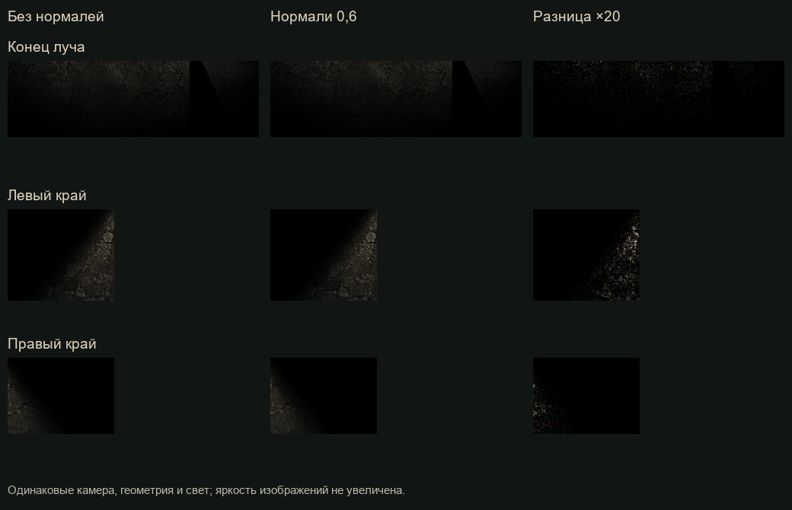

# Изменения: свет, стекло, вой и глубина сцены

- Уведомления появляются на 28 px ниже своей строки, поднимаются к ней и занимают строки сверху вниз. Первая строка находится на 42 px ниже центра игрока.
- При заряде фонаря ≤25% появляются короткие провалы яркости. Активный монстр ближе 260 единиц вызывает более частое моргание. Эффект управляет общей силой луча, включая пол и маску видимости.
- В сцене сохранены 13 небольших скоплений стекла. Шаг по ним воспроизводит одну из трёх оригинальных записей, исключая предыдущую. Радиус шума 12000: даже после ослабления стеной монстр слышит стекло через всю существующую карту.
- Подбор фигурки воспроизводит loottoy.mp3.
- Первый вой — оригинальный voy.mp3. Из voy2.mp3 выделены четыре фрагмента по паузам: примерно 0–2,69; 7,74–11,33; 16,72–19,55; 26,08–28,77 секунды. Исходные MP3 сохранены без изменений в assets/audio/user_originals.
- Вой начинается на первом обновлении монстра и повторяется каждые 25–30 секунд. Каждый из пяти вариантов имеет равную вероятность среди разрешённых, предыдущий исключён. Источник пространственного звука следует за монстром. Все новые звуки проходят через Master с общими отражениями и реверберацией.
- В overhead.tscn сохранены три слоя Parallax2D: трубы, балки, провода. Скорости 1,012 / 1,022 / 1,032. Они остаются под маской видимости.
- Стены получили сохраняемый в wall.tscn узел Height: неподвижное основание, верх со смещением до 12 единиц и соединяющие боковины. Коллизия и дверные проходы используют исходное основание. Обновление геометрии ограничено 30 Гц, областью камеры и изменением смещения более 0,2 единицы. Редактор показывает ту же модель с исходным смещением.

## Нормали

Одинаковая неподвижная сцена, zoom 0,48, normal_strength 0 / 0,6. Повторный кадр без нормалей совпал точно. Средняя абсолютная разница RGB в диапазоне 0–1:

| Область | Средняя разница | Максимальная разница |
|---|---:|---:|
| Конец луча | 0,000461 | 0,019608 |
| Левый край | 0,000952 | 0,066667 |
| Правый край | 0,000311 | 0,031373 |

В самом слабом свете эффект почти исчезает: вклад рельефа умножается на затухание луча. Это не увеличивает яркость тёмных участков искусственно. Визуально нормали оставлены на 0,6; при нулевой силе добавлен обход чтения текстуры нормалей и расчёта рельефа.

## Проверки и ограничения замера

Godot 4.7.2, D3D12 Forward+, RTX 3050 Laptop, 1280×720. Четыре коротких серии по 90 кадров: без/с/с/без нормалей — 0,915 / 0,925 / 0,829 / 0,655 мс на кадр по настенным часам. Разброс и прогрев превышают измеряемый эффект; эти числа не являются изолированным GPU-профилем или гарантией FPS. Устойчивого замедления от нормалей в этом замере не обнаружено.

Бенчмарк геометрии видимости: 3,988 мс без кеша и 1,833 мс с существующим кешем, одинаковый результат геометрии. Это время обновления видимости, а не всего кадра.

Пройдены gameplay_smoke, requested_polish_regression, notification_queue_regression и normal_map_comparison. Проверены граница 25%, близкий монстр при полном заряде, неповторение звуков, интервал воя, сохранённые скопления стекла и порядок/направление движения уведомлений. Экспорт не выполнялся.

Рендер прошёл с предупреждением движка о недоступной папке кеша шейдеров user://; измерения короткие, без долговременной проверки на разных устройствах.

Дополнительно пройдены chase_editor_audio_regression и проверка внутреннего угла с реальным рендером: 1424 закрытых и 496 открытых образцов, 0 утечек света и 0 ложных теней.
